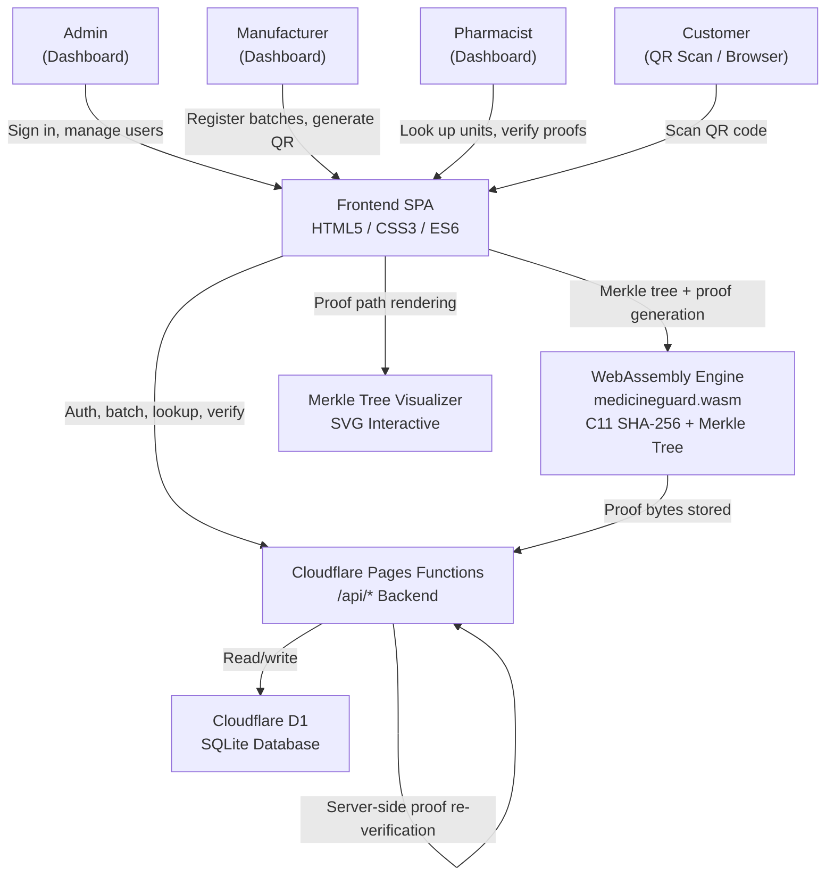

# MedicineGuard

**Medicine Batch Traceability and Verification Using Merkle Trees**

[](https://medicineguard.pages.dev/)
[](https://github.com/vardhan-kadali/MedicineGuard)
[](https://medicineguard.pages.dev/)
[]()

---

> **Live Application:** [https://medicineguard.pages.dev/](https://medicineguard.pages.dev/)  
> **GitHub Repository:** [https://github.com/vardhan-kadali/MedicineGuard](https://github.com/vardhan-kadali/MedicineGuard)

---

## Table of Contents

1. [What Is MedicineGuard?](#1-what-is-medicineguard)
2. [The Problem It Addresses](#2-the-problem-it-addresses)
3. [Trust Boundary and Mandatory Disclaimer](#3-trust-boundary-and-mandatory-disclaimer)
4. [Technology Stack](#4-technology-stack)
5. [System Architecture](#5-system-architecture)
6. [User Roles and Features](#6-user-roles-and-features)
7. [Cryptographic Implementation](#7-cryptographic-implementation)
8. [Database and Backend API](#8-database-and-backend-api)
9. [Security Measures](#9-security-measures)
10. [Testing and Validation](#10-testing-and-validation)
11. [Production Deployment](#11-production-deployment)
12. [Running the Project Locally](#12-running-the-project-locally)
13. [Project Status](#13-project-status)
14. [Development Roadmap](#14-development-roadmap)
15. [Known Limitations](#15-known-limitations)
16. [Contributing](#16-contributing)
17. [Repository Layout](#17-repository-layout)

---

## 1. What Is MedicineGuard?

MedicineGuard is an academic prototype demonstrating how cryptographic hashing and binary Merkle Trees can be applied to pharmaceutical supply-chain record traceability. It allows authorized users to register medicine batch records, generate cryptographic commitments for those records, and later verify that any individual medicine unit's digital record has not been modified since registration.

The core concepts are:

- **SHA-256 hashing** (implemented from scratch in C11, compiled to WebAssembly) to generate tamper-evident digests of medicine records.
- **Binary Merkle Trees** to organize and commit an entire batch of units into a single 32-byte root hash.
- **Merkle Proofs** (MGP1 wire format) allowing any single unit's inclusion in the committed batch to be verified in O(log N) steps, without downloading the full batch.
- **QR codes** that encode a unique verification reference, enabling customer verification through a public browser interface.
- **Cloudflare Pages Functions** and **D1** providing the authenticated API, database, role-based access control, and audit logging.

The project is built for academic study of Data Structures and Algorithms (DAA) and Applied Cryptography. It is not a certified pharmaceutical product.

---

## 2. The Problem It Addresses

In pharmaceutical supply chains:

- Customers cannot independently verify whether a medicine batch has been modified or recalled after leaving the manufacturer.
- Storing individual cryptographic signatures for thousands of medicine units per batch is storage-intensive.
- Centralized ledgers are vulnerable to retroactive data tampering.
- Verifying one unit using a simple whole-batch hash requires downloading the entire batch dataset.

MedicineGuard demonstrates how a Merkle Tree commitment solves the last problem: a single unit can be verified in O(log N) steps using only a small proof path, without exposing the rest of the batch. The committed Merkle Root forms a tamper-evident fingerprint of the entire batch at registration time.

---

## 3. Trust Boundary and Mandatory Disclaimer

> [!IMPORTANT]
> **MedicineGuard Trust Boundary**
>
> MedicineGuard verifies the integrity of a **digital medicine record** against a registered Merkle Tree commitment. A successful verification proves mathematically that the digital record has not been altered since the batch was committed.
>
> **This does not establish:**
> - The chemical composition or purity of a physical medicine tablet.
> - The physical medicine's safety, storage conditions, or shelf life.
> - That the manufacturer named in the record is a legitimate licensed entity.
> - That the QR code or its label has not been copied or reproduced by a third party.
>
> *Mandatory Disclaimer (reproduced in every API response):*
> "MedicineGuard verifies the digital medicine record against a registered Merkle Tree commitment. This does not independently establish the physical medicine's chemical composition, safety, storage conditions, manufacturer legitimacy or guarantee that the QR code has not been copied."

---

## 4. Technology Stack

| Layer | Technology | Purpose |
|:---|:---|:---|
| **Cryptographic Engine** | C11 (GCC / Clang) | SHA-256 (FIPS 180-4), Merkle Tree, proof generation and verification |
| **WebAssembly Runtime** | Emscripten (`emcc -O3`) | Compiles C engine to `medicineguard.wasm` for browser execution |
| **WASM JavaScript Loader** | Vanilla ES6 Module (`wasm-loader.js`) | HEAPU8-safe JS API wrapping the C WASM ABI |
| **Frontend** | HTML5, CSS3, Vanilla JavaScript (ES6 modules) | Single-page application, role dashboards, QR, Merkle Visualizer |
| **QR Code Generation** | `qrcode-generator` v2.0.4 | Offline QR code matrix generation in-browser |
| **QR Code Scanning** | `jsQR` v1.4.0 | Camera-based QR code decoding in-browser |
| **Backend API** | Cloudflare Pages Functions (JavaScript) | Serverless `/api/*` route handlers |
| **Authentication** | Web Crypto API — PBKDF2-HMAC-SHA256 | Password hashing, session tokens, CSRF protection |
| **Database** | Cloudflare D1 (SQLite-compatible) | Persistent storage for users, batches, units, sessions, audit logs |
| **Deployment** | Cloudflare Pages | Static hosting + Functions + D1 binding |
| **Configuration** | Wrangler v3/v4 (JSONC) | Local dev server, D1 migrations, Pages deployment |
| **Build System** | GNU Make (native C), Batch scripts (WASM, tests) | Native binary and WASM compilation |
| **Version Control** | Git / GitHub | Source control and Pages Git integration |

No external CSS frameworks, CDNs, or UI libraries are used in the frontend.

---

## 5. System Architecture

### High-Level Component Diagram

```
┌─────────────────────────────────────────────────────────────────┐
│                      Browser (Client Side)                      │
│                                                                 │
│   public/index.html — Single-Page Application                   │
│   public/css/app.css — All styling                              │
│   public/js/app.js — Routing, auth, role dashboards            │
│   public/js/wasm-loader.js — C engine WASM interface           │
│   public/js/merkle-visualizer.js — Interactive SVG visualizer  │
│   public/js/vendor/qrcode.js — QR generation                   │
│   public/js/vendor/jsqr.js — QR camera scanning                │
│                        │                                        │
│   public/wasm/medicineguard.wasm  ─── C11 engine (WASM)        │
│   public/wasm/medicineguard.js    ─── Emscripten JS glue       │
└─────────────────────┬───────────────────────────────────────────┘
                      │  HTTP /api/* requests (authenticated)
                      │  HTTP /api/public/verify (unauthenticated)
                      ▼
┌─────────────────────────────────────────────────────────────────┐
│               Cloudflare Pages Functions (Backend)              │
│                                                                 │
│   functions/api/auth/           — Login, logout, session, CSRF │
│   functions/api/auth/bootstrap  — One-time admin initialization │
│   functions/api/admin/users     — User management (admin only) │
│   functions/api/manufacturer/   — Batch initiation & publishing│
│   functions/api/pharmacist/     — Batch lookup & audit trail   │
│   functions/api/public/verify   — Public verification endpoint  │
│   functions/_shared/            — Auth, Merkle verifier, utils │
│                        │                                        │
│   Server-side Merkle proof re-verification using Web Crypto     │
└─────────────────────┬───────────────────────────────────────────┘
                      │  D1 binding: DB
                      ▼
┌─────────────────────────────────────────────────────────────────┐
│                     Cloudflare D1 (SQLite)                      │
│                                                                 │
│   users  ·  sessions  ·  batches  ·  medicine_units            │
│   verification_logs  ·  batch_events  ·  customer_verifications │
└─────────────────────────────────────────────────────────────────┘
```

### Mermaid Architecture Diagram



### What Happens When a Manufacturer Registers a Batch

1. The Manufacturer signs in and navigates to the Manufacturer dashboard.
2. They enter batch metadata (batch ID, medicine name, manufacturing date, expiry date) and unit count.
3. The browser's WebAssembly engine serializes each unit into the canonical MG01 binary format.
4. The C engine (via WASM) builds a binary Merkle Tree from all unit records, computing domain-separated SHA-256 leaf and parent hashes.
5. The resulting 32-byte Merkle Root and the MGP1 binary proof for each unit are captured by JavaScript.
6. The batch is initiated on the backend via `POST /api/manufacturer/batches` (storing the Merkle Root).
7. Units with their proof bytes are uploaded in chunks via `POST /api/manufacturer/batches/:batchId/units`. The backend independently re-verifies each proof against the committed root using a server-side Web Crypto Merkle verifier.
8. Once all units are uploaded and verified, the Manufacturer publishes the batch (`POST /api/manufacturer/batches/:batchId/publish`), making records queryable by Pharmacists and Customers.
9. Each published unit gets a unique 32-character hex verification reference stored in the database, used as the QR code payload.

### What Happens When a Customer Scans a QR Code

1. The Customer scans a QR code using their browser camera (via `jsQR`) or types a verification reference manually.
2. The browser sends `GET /api/public/verify?reference=<32-hex-chars>` — no authentication required.
3. The backend validates the 32-character hex format, then queries the database for the matching unit and its parent batch.
4. If the batch is revoked, a `403 REVOKED` response is returned with the revocation reason.
5. If the batch is published, the backend re-runs a full Merkle proof verification using the stored proof bytes and the committed Merkle Root via `functions/_shared/merkle-verifier.js`.
6. A verified result (`verified: true`, `status: VERIFIED`) or failure reason is returned, always accompanied by the mandatory trust disclaimer.
7. The verification event is logged in the `customer_verifications` table (with hashed IP for privacy).

---

## 6. User Roles and Features

### Admin

The Admin role has full authority over user management. Backend authorization is enforced server-side via `requireAuth(context, ['admin'])`.

| Feature | Status |
|:---|:---|
| Sign in and receive HttpOnly session cookie | DONE — implemented and locally tested |
| List all registered users | DONE — `GET /api/admin/users` |
| Create Manufacturer or Pharmacist accounts | DONE — `POST /api/admin/users` |
| Enable or disable user accounts | DONE — `PATCH /api/admin/users/:id` |
| Reset user passwords | DONE — `POST /api/admin/users/:id/reset-password` |
| One-time bootstrap of first Admin account | DONE — `POST /api/auth/bootstrap` with `BOOTSTRAP_ADMIN_SECRET` |
| Admin panel visible in UI | DONE — hidden unless `role === 'admin'` returned from session |
| Production Admin initialization | PENDING VALIDATION — not yet performed in production |

### Manufacturer

| Feature | Status |
|:---|:---|
| Sign in with Manufacturer credentials | DONE — implemented and locally tested |
| In-browser Merkle tree construction via WASM | DONE — C engine executes in browser |
| Initiate a batch with Merkle Root | DONE — `POST /api/manufacturer/batches` |
| Upload units with MGP1 proofs (server re-verified) | DONE — `POST /api/manufacturer/batches/:batchId/units` |
| Publish batch to shared registry | DONE — `POST /api/manufacturer/batches/:batchId/publish` |
| View own batch list and unit references | DONE — `GET /api/manufacturer/batches` |
| Abort an uploading batch | DONE — `POST /api/manufacturer/batches/:batchId/abort` |
| Revoke a published batch with reason | DONE — `POST /api/manufacturer/batches/:batchId/revoke` |
| QR code generation for each unit (offline, in-browser) | DONE — using `qrcode-generator` |
| End-to-end batch registration in production | PENDING VALIDATION |

### Pharmacist

| Feature | Status |
|:---|:---|
| Sign in with Pharmacist credentials | DONE — implemented and locally tested |
| Look up a medicine unit by unit ID (across published batches) | DONE — `GET /api/pharmacist/lookup?unit_id=...` |
| Scoped lookup by unit ID and batch ID | DONE — `GET /api/pharmacist/lookup?unit_id=...&batch_id=...` |
| Ambiguous unit ID detection (unit exists in multiple batches) | DONE — returns `409 AMBIGUOUS_UNIT_ID` |
| Client-side WASM Merkle proof re-verification | DONE — browser verifies retrieved proof against stored root |
| List published batches | DONE — `GET /api/pharmacist/batches` |
| Submit and retrieve verification audit entries | DONE — `POST /api/pharmacist/verifications`, `GET /api/pharmacist/verifications` |
| End-to-end Pharmacist workflow in production | PENDING VALIDATION |

### Customer

| Feature | Status |
|:---|:---|
| Scan QR code with browser camera | DONE — `jsQR` integration |
| Manual verification reference entry | DONE |
| Public verification (no login required) | DONE — `GET /api/public/verify?reference=...` |
| Verified result with medicine record details | DONE |
| Revoked batch detection and notification | DONE |
| Rate limiting on failed lookups (10/minute) | DONE |
| Trust disclaimer in every response | DONE |
| End-to-end QR scan and verification in production | PENDING VALIDATION |

---

## 7. Cryptographic Implementation

### SHA-256

The SHA-256 implementation in `core-c/src/sha256.c` follows **FIPS PUB 180-4** exactly. It is a pure C11 implementation with no external library dependencies, using:

- Standard FIPS initial hash values (fractional parts of square roots of first 8 primes).
- 64-round compression with FIPS round constants.
- Streaming incremental hashing via `sha256_init`, `sha256_update`, `sha256_final`.
- A one-shot convenience function `sha256_hash`.
- `crypto_memcmp` — constant-time memory comparison to prevent timing side-channel attacks.

**How changes affect hashes:** Due to the avalanche effect, altering even a single character in a medicine record (e.g., changing one digit in the expiry date) produces a completely different 32-byte hash. This means any tampered record is immediately detected when its hash is recomputed and compared.

### MG01 Canonical Serialization

Before hashing, every medicine record is serialized into a deterministic binary format called **MG01**. This guarantees that the same logical record always produces the same hash, regardless of platform.

```
┌──────────┬────────────────┬──────────────────────────┬─── ... ─┐
│ "MG01"   │ 4-byte BE len  │ UTF-8 field bytes        │ (×5 flds│
│ (4 bytes)│ per field      │ batch_id, unit_id,       │  total) │
└──────────┴────────────────┴──────────────────────────┴─── ... ─┘
```

Fields in order: `batch_id`, `unit_id`, `medicine_name`, `manufacturing_date`, `expiry_date`. Each field is prefixed by its 4-byte big-endian byte length.

### Domain Separation

MedicineGuard enforces RFC 6962-style domain separation to prevent second-preimage attacks against naive Merkle trees:

```
Leaf hash:    SHA-256( 0x00 || MG01(record) )
Parent hash:  SHA-256( 0x01 || left_hash || right_hash )
```

Because leaf and parent prefixes differ (`0x00` vs `0x01`), an attacker cannot present an internal tree node as a valid leaf record.

### Binary Merkle Tree Construction

```
         [Root]
        /       \
    [P01]       [P23]
    /   \       /   \
  [L0] [L1]  [L2] [L3]
```

Where `[L0]` = SHA-256(0x00 || MG01(unit_0)), `[P01]` = SHA-256(0x01 || L0 || L1), etc.

**Odd-Node Promotion:** When a level has an odd number of nodes, the last unpaired node is promoted to the next level *unchanged*, without being hashed with itself. This avoids the duplicate-node vulnerability (CVE-2012-2459) present in some Bitcoin-style implementations. The visualizer explicitly marks these promotions.

**Tree height:** ⌈log₂(N)⌉ + 1 levels. A batch of 1,000 units produces a tree of height 11 (10 sibling hashes sufficient to prove any unit).

### MGP1 Merkle Proof Wire Format

Each proof is serialized to a compact binary format called **MGP1**:

```
┌────────────┬─────────────┬──────────────┬─────────────┬──────────────────────────┐
│ "MGP1"     │ leaf_index  │ total_leaves │ step_count  │ proof steps              │
│ (4 bytes)  │ (4-byte BE) │ (4-byte BE)  │ (2-byte BE) │ (step_count × 33 bytes)  │
└────────────┴─────────────┴──────────────┴─────────────┴──────────────────────────┘
```

**Header Layout (14 bytes total):**
- **Bytes 0..3 (`magic`):** ASCII `"MGP1"` (`0x4D, 0x47, 0x50, 0x31`)
- **Bytes 4..7 (`leaf_index`):** 32-bit unsigned big-endian integer ($0 \le \text{leaf\_index} < \text{total\_leaves}$)
- **Bytes 8..11 (`total_leaves`):** 32-bit unsigned big-endian integer ($N \ge 1$)
- **Bytes 12..13 (`step_count`):** 16-bit unsigned big-endian integer ($0 \le \text{step\_count} \le 32$)

**Step Payload (`step_count × 33` bytes):**
Each step encodes one sibling along the authentication path:
- **32 bytes:** SHA-256 hash of the sibling node
- **1 byte:** Direction flag:
  - `0x00` (`SIBLING_LEFT`): Sibling is on the left; parent hash is computed as `SHA-256(0x01 || sibling_hash || current_hash)`
  - `0x01` (`SIBLING_RIGHT`): Sibling is on the right; parent hash is computed as `SHA-256(0x01 || current_hash || sibling_hash)`

**Total Wire Size:** $14 + 33 \times \text{step\_count}$ bytes. (For example, an $N=1,000$ tree requires at most 10 steps = 344 bytes total).

### Proof Verification (C, WASM, and Server-Side)

Verification recomputes the root by traversing the proof steps from the leaf upward:

1. Recompute leaf hash: `SHA-256(0x00 || MG01(record))`
2. For each proof step: `hash = SHA-256(0x01 || left || right)` based on direction.
3. Compare final recomputed root against trusted committed Merkle Root.

This runs in three contexts:
- **Native C** — test suite validation.
- **Browser WASM** — Pharmacist and Manufacturer client-side verification.
- **Cloudflare Pages Function** — `functions/_shared/merkle-verifier.js` re-runs the same algorithm using Web Crypto API for every public verification request and every unit upload, ensuring the server never trusts unverified proof bytes.

---

## 8. Database and Backend API

### Database Binding

The production Cloudflare D1 database is accessed in all Functions via `context.env.DB`. The binding is configured as `DB` in `wrangler.jsonc`.

```jsonc
{
  "d1_databases": [
    {
      "binding": "DB",
      "database_name": "medicineguard-db",
      "database_id": "4f4db0aa-3bae-46cc-94f6-f1073b184a0b",
      "migrations_dir": "migrations"
    }
  ]
}
```

### Database Tables

| Table | Purpose |
|:---|:---|
| `users` | Registered accounts with hashed passwords, roles, and account status |
| `sessions` | Active sessions with hashed tokens, CSRF token hashes, and expiry |
| `batches` | Medicine batch registrations with Merkle Root and publication status |
| `medicine_units` | Individual unit records with MGP1 proof bytes and verification references |
| `verification_logs` | Pharmacist verification audit trail |
| `batch_events` | Timeline of batch lifecycle events (CREATED, PUBLISHED, REVOKED) |
| `customer_verifications` | Public QR verification attempts with hashed IP and outcome |

### Migration History

| File | Description |
|:---|:---|
| `migrations/0001_initial_schema.sql` | Creates all core tables and indexes |
| `migrations/0002_phase4_schema.sql` | Adds `revoked` status, `revoked_at`, `revocation_reason` to batches; adds `customer_verifications` table |

Both migrations have been applied to the production Cloudflare D1 database (`medicineguard-db`).

### API Reference

The backend exposes 21 RESTful API endpoints across authentication, administration, manufacturing, pharmacy, and public verification:

| Method | Endpoint | Purpose | Auth |
|:---|:---|:---|:---|
| `POST` | `/api/auth/bootstrap` | One-time admin account creation using `BOOTSTRAP_ADMIN_SECRET` | Secret only |
| `POST` | `/api/auth/login` | Authenticate user, receive HttpOnly session cookie + CSRF token | None |
| `POST` | `/api/auth/logout` | Revoke current session and clear session cookie | Session cookie (optional) |
| `GET` | `/api/auth/session` | Check current session, refresh CSRF token, and return user role | Session cookie (optional) |
| `POST` | `/api/auth/change-password` | Change authenticated user's password | Any authenticated role |
| `GET` | `/api/admin/users` | List all registered users | Admin |
| `POST` | `/api/admin/users` | Create a new user (Manufacturer or Pharmacist) | Admin |
| `PATCH` | `/api/admin/users/:id` | Enable or disable a user account (revoking sessions on disable) | Admin |
| `POST` | `/api/admin/users/:id/reset-password` | Reset a user's password | Admin |
| `GET` | `/api/manufacturer/batches` | List own batches (or all batches for Admin) | Manufacturer / Admin |
| `POST` | `/api/manufacturer/batches` | Initiate a new batch with Merkle Root | Manufacturer |
| `POST` | `/api/manufacturer/batches/:batchId/units` | Upload units with MGP1 proofs (server re-verifies each) | Manufacturer |
| `GET` | `/api/manufacturer/batches/:batchId/units` | List units in batch (supports `?page=`, `?limit=`, `?search=`) | Manufacturer / Admin |
| `POST` | `/api/manufacturer/batches/:batchId/publish` | Finalize and publish an uploaded batch | Manufacturer |
| `POST` | `/api/manufacturer/batches/:batchId/abort` | Abort an uploading batch | Manufacturer / Admin |
| `POST` | `/api/manufacturer/batches/:batchId/revoke` | Revoke a published batch with a reason | Manufacturer / Admin |
| `GET` | `/api/pharmacist/batches` | List published batches | Pharmacist / Admin / Manufacturer |
| `GET` | `/api/pharmacist/lookup` | Look up a unit by unit_id (and optionally batch_id) | Pharmacist / Admin / Manufacturer |
| `POST` | `/api/pharmacist/verifications` | Submit a verification audit log entry | Pharmacist / Admin |
| `GET` | `/api/pharmacist/verifications` | Retrieve verification audit history | Pharmacist / Admin |
| `GET` | `/api/public/verify` | Public verification by 32-hex reference (no auth, rate-limited) | None |

### Routing

`public/_routes.json` limits Worker invocations to `/api/*` only. All static assets are served directly from Cloudflare's edge cache, reducing Worker execution cost.

---

## 9. Security Measures

The following security measures are implemented and verifiable in the source code:

| Measure | Location | Detail |
|:---|:---|:---|
| PBKDF2-HMAC-SHA256 password hashing | `functions/_shared/auth.js` | 600,000 iterations, 128-bit random salt per user |
| Constant-time string comparison | `functions/_shared/auth.js` | Prevents timing side-channel on credential comparison |
| Constant-time memory comparison (C) | `core-c/src/sha256.c` | `crypto_memcmp` for hash comparison |
| HttpOnly session cookies | `functions/_shared/auth.js` | Cookie set with `HttpOnly; Secure; SameSite=Lax` |
| CSRF token protection | `functions/_shared/auth.js` | 64-hex-char CSRF token required on all mutating requests |
| Role-based access control | `functions/_shared/auth.js` | `requireAuth(context, ['role'])` on every protected endpoint |
| Session revocation on account disable | `functions/api/admin/users/[id].js` | Disabling a user immediately revokes active sessions |
| Input validation | `functions/_shared/validation.js` | Email format, date range, hex string format, field presence |
| Reference format enforcement | `functions/api/public/verify.js` | 32-character hex regex before any database query |
| Rate limiting on failed lookups | `functions/api/public/verify.js` | 10 failed lookups / 60-second window per hashed IP |
| Server-side Merkle proof re-verification | `functions/_shared/merkle-verifier.js` | Server never trusts client-submitted proof bytes |
| IP hashing for audit logs | `functions/api/public/verify.js` | SHA-256 of client IP stored, raw IP never persisted |
| Content Security Policy | `public/_headers` | `default-src 'self'; script-src 'self' 'wasm-unsafe-eval'` |
| Security headers | `public/_headers` | `X-Frame-Options: DENY`, `X-Content-Type-Options: nosniff`, `Referrer-Policy` |
| Bootstrap lockout | `functions/api/auth/bootstrap.js` | Permanently rejects bootstrap after first admin exists (`ADMIN_ALREADY_EXISTS`) |
| Local secrets isolation | `.gitignore` + `.dev.vars` | `.dev.vars`, `.wrangler/`, `*.sqlite*` are all git-ignored |

### Files That Must Never Be Committed

| File / Directory | Reason |
|:---|:---|
| `.dev.vars` | Contains `BOOTSTRAP_ADMIN_SECRET` for local development |
| `.wrangler/` | Local D1 database state and runtime cache |
| `*.sqlite*` | Local database files |
| `node_modules/` | Dependencies |
| `*.log`, `*.tmp` | Temporary output |

The production `BOOTSTRAP_ADMIN_SECRET` is configured as an **encrypted environment variable** in the Cloudflare Pages dashboard and is never stored in source files, `wrangler.jsonc`, or this repository.

---

## 10. Testing and Validation

### Automated Test Suite

All automated tests run locally against the Wrangler development server and local D1 database. No remote infrastructure is required to run tests.

| Test Area | Assertions | Command | Evidence |
|:---|:---|:---|:---|
| Native C SHA-256 (NIST vectors, incremental, timing) | 6 | `npm run test:native` | `core-c/tests/test_sha256.c` |
| Native C Merkle Tree (construction, proofs, N=1–10,000, negative security) | 61 | `npm run test:native` | `core-c/tests/test_merkle.c` |
| WebAssembly ABI (handle pool, WASM proof generation, parity with C) | 314 | `npm run test:wasm` | `scripts/test_wasm.js` |
| Manufacturer portal — Merkle root, proof audit, tamper detection | 388 | `npm run test:phase3b` | `scripts/audit_phase3b.js` |
| Pharmacist portal — lookup, WASM re-verify, negative security | 177 | `npm run test:phase3c` | `scripts/test_phase3c.js` |
| Backend API — auth, RBAC, D1, batch publishing, server proof verification | 139 | `npm run test:phase3d` | `scripts/test_phase3d.mjs` |
| QR codes, public verification, rate limiting, revocation | 95 | `npm run test:phase4` | `scripts/test_phase4.mjs` |
| Merkle visualizer, security headers, end-to-end workflow, scalability (N=1,000) | 140 | `npm run test:phase5` | `scripts/test_phase5.mjs` |
| **Total** | **1,320** | `npm run test:all` | All 7 suites |

The last confirmed cumulative run of `npm run test:all` passed 1,320/1,320 assertions against the local Wrangler development server.

> [!NOTE]
> These results reflect automated tests running against a **local Wrangler dev server** with a **local D1 database**. They are not production environment test results. Production workflows require separate end-to-end validation after the production Admin account is initialized.

### Additional Test Scripts

| Script | Purpose |
|:---|:---|
| `scripts/audit_secrets.mjs` | Verifies no secrets are tracked in Git history or staged files |
| `scripts/test_auth_flow.mjs` | Browser-automation test of sign-in, session, and bootstrap flows |
| `scripts/benchmark_visualizer.mjs` | Performance benchmark of visualizer against WASM engine at N=100 and N=1,000 |
| `scripts/verify_full_system.mjs` | End-to-end multi-role workflow verification |

### Production vs. Local Testing

| Item | Status |
|:---|:---|
| All 7 automated suites pass locally | Confirmed (1,320/1,320) |
| Application deployed to Cloudflare Pages | Confirmed (commit `d8a6d5e`, November 14, 2026) |
| Production D1 schema migrations applied | Confirmed (both migrations applied remotely) |
| Production Admin account initialized | **Pending — not yet performed** |
| Production end-to-end batch registration | **Pending validation** |
| Production QR scan and customer verification | **Pending validation** |

---

## 11. Production Deployment

### Deployment Details

| Property | Value |
|:---|:---|
| **Platform** | Cloudflare Pages |
| **Production URL** | [https://medicineguard.pages.dev/](https://medicineguard.pages.dev/) |
| **GitHub Repository** | [https://github.com/vardhan-kadali/MedicineGuard](https://github.com/vardhan-kadali/MedicineGuard) |
| **Production Branch** | `master` |
| **Build Output Directory** | `public` |
| **Build Command** | *(empty — WASM assets are precompiled and committed)* |
| **Functions Directory** | `functions/` (auto-detected by Cloudflare Pages) |
| **Latest Deployed Commit** | `d8a6d5e7c95479293a3c51f625e3bcd2cf81ca06` |
| **D1 Database** | `medicineguard-db` (`4f4db0aa-3bae-46cc-94f6-f1073b184a0b`) |
| **D1 Binding Name** | `DB` |
| **Deployment Date** | November 14, 2026 |

### Why WASM Assets Are Precompiled

The WebAssembly binary (`public/wasm/medicineguard.wasm`) and its Emscripten JavaScript glue (`public/wasm/medicineguard.js`) are committed directly to the repository. Cloudflare Pages build runners do not have Emscripten installed, so precompiling locally and committing the outputs avoids a custom build step in the CI/CD pipeline.

To rebuild the WASM binary locally (requires Emscripten SDK):

```bat
scripts\build_wasm.bat
```

### Production Deployment Configuration

The following must be configured in the **Cloudflare Pages Dashboard** (Settings → Functions and Settings → Environment variables):

| Resource | Type | Required Value |
|:---|:---|:---|
| D1 Database Binding | Function binding | Variable: `DB`, Database: `medicineguard-db` |
| `BOOTSTRAP_ADMIN_SECRET` | Encrypted environment variable | A strong random secret (never committed to Git) |

> [!CAUTION]
> Do not reuse the placeholder value from `.dev.vars.example` in production. Generate a fresh cryptographically strong secret for the production environment.

### Git Integration and Automatic Deployments

Pushing to `master` automatically triggers a new Cloudflare Pages deployment. The deployment-specific URL for any build follows the pattern `https://<hash>.medicineguard.pages.dev/`.

---

## 12. Running the Project Locally

### Prerequisites

| Requirement | Notes |
|:---|:---|
| **Node.js** v18 or later | Required for Wrangler and test scripts |
| **npm** | Installed with Node.js |
| **GCC or Clang** (C11) | Required for native C test suite only |
| **GNU Make** | Required for native C build only |
| **Emscripten SDK** (`emcc`) | Required only if rebuilding the WASM binary |
| **Git** | For cloning the repository |

> The precompiled WASM binary in `public/wasm/` means you do **not** need Emscripten to run or test the application.

### Setup Steps

**1. Clone the repository**

```bash
git clone https://github.com/vardhan-kadali/MedicineGuard.git
cd MedicineGuard
```

**2. Install Node.js dependencies**

```bash
npm install
```

**3. Configure local environment variables**

```bash
# Copy the example file and edit it
copy .dev.vars.example .dev.vars
```

Open `.dev.vars` and set a local bootstrap secret:

```
BOOTSTRAP_ADMIN_SECRET=your_local_secret_here
```

> [!WARNING]
> Never commit `.dev.vars` to Git. It is listed in `.gitignore` and must stay there.

**4. Apply database migrations to the local D1 instance**

```bash
# Using the npm script shortcut:
npm run migrate:local

# Or directly with Wrangler:
npx wrangler d1 migrations apply medicineguard-db --local
```

This creates the local SQLite database inside `.wrangler/state/v3/d1/` (which is also git-ignored).

**5. Start the local development server**

```bash
npm run dev
# or directly:
npx wrangler pages dev public --d1=DB
```

The server starts at `http://127.0.0.1:8788/`.

**Why not `python -m http.server`?**
A plain static file server cannot run Cloudflare Pages Functions, cannot bind to the local D1 database, and cannot handle authentication or API routes. You must use `wrangler pages dev` for a full local environment.

**6. Bootstrap the first local Admin account**

1. Open `http://127.0.0.1:8788/` in your browser.
2. Click **Sign In** in the top bar.
3. Select the **Admin Bootstrap** tab.
4. Enter your desired admin email, a strong password, and the `BOOTSTRAP_ADMIN_SECRET` value from your `.dev.vars` file.
5. Click **Bootstrap**. The endpoint permanently rejects further bootstrap attempts once an Admin exists.

**7. Run the automated test suites**

```bash
# All suites (requires the local dev server to be running)
npm run test:all

# Individual suites
npm run test:native     # Native C SHA-256 and Merkle Tree (no server needed)
npm run test:wasm       # WebAssembly ABI tests (no server needed)
npm run test:phase3b    # Manufacturer audit (no server needed)
npm run test:phase3c    # Pharmacist portal (requires local server)
npm run test:phase3d    # Backend auth and D1 (requires local server)
npm run test:phase4     # QR and public verification (requires local server)
npm run test:phase5     # Visualizer and security (requires local server)
```

**8. Build the native C engine (optional)**

Requires GCC and GNU Make:

```bash
make check
```

### Environment Variable Reference

| Variable | File | Required Locally | Purpose |
|:---|:---|:---|:---|
| `BOOTSTRAP_ADMIN_SECRET` | `.dev.vars` | Yes | Secret for one-time Admin account initialization. Set to any string locally. Never use the production value locally. |

---

## 13. Project Status

> **Current milestone:** MedicineGuard has reached initial production deployment. The application, Cloudflare Pages Functions, and production D1 database schema are deployed and operational. The immediate next milestone is production Admin initialization followed by complete end-to-end validation of the medicine registration and customer verification workflow.

### Implementation Checklist

| Component | Status |
|:---|:---|
| C11 SHA-256 engine (FIPS 180-4) | DONE |
| Binary Merkle Tree with odd-node promotion | DONE |
| MGP1 proof generation and verification (C) | DONE |
| Native C test suite | DONE |
| WebAssembly compilation (Emscripten) | DONE |
| WASM JavaScript ABI loader | DONE |
| WASM test suite | DONE |
| MG01 canonical serialization | DONE |
| Frontend SPA (HTML/CSS/JS) | DONE |
| Manufacturer dashboard | DONE |
| Pharmacist dashboard | DONE |
| Customer verification page | DONE |
| Interactive Merkle Tree Visualizer | DONE |
| Admin dashboard | DONE |
| Cloudflare Pages Functions (all API routes) | DONE |
| PBKDF2-HMAC-SHA256 authentication | DONE |
| HttpOnly session cookies + CSRF tokens | DONE |
| Role-based access control | DONE |
| D1 schema design and migrations | DONE |
| Server-side Merkle proof re-verification | DONE |
| QR code generation (offline, in-browser) | DONE |
| QR code scanning (camera, in-browser) | DONE |
| Batch revocation and customer rejection | DONE |
| Rate limiting on public verification | DONE |
| Security headers (`_headers`) | DONE |
| Automated test suite (1,320 assertions locally) | DONE |
| GitHub repository published (public) | DONE |
| Cloudflare Pages deployment | DONE |
| Production D1 schema migrations applied | DONE |
| **Production Admin account initialization** | **PENDING VALIDATION** |
| **Production Admin user management** | **PENDING VALIDATION** |
| **Production Manufacturer batch registration** | **PENDING VALIDATION** |
| **Production QR generation and customer scan** | **PENDING VALIDATION** |
| **Production Pharmacist lookup and verification** | **PENDING VALIDATION** |
| **Production database read/write end-to-end** | **PENDING VALIDATION** |

---

## 14. Development Roadmap

### Phase 1 — Production Initialization (Next Step)

- [ ] Add `BOOTSTRAP_ADMIN_SECRET` as an encrypted environment variable in the Cloudflare Pages dashboard.
- [ ] Confirm D1 binding (`DB` → `medicineguard-db`) is active in Pages Functions settings.
- [ ] Send the bootstrap request to `POST /api/auth/bootstrap` to create the first production Admin.
- [ ] Verify Admin login succeeds and returns `role: admin`.
- [ ] Confirm the bootstrap endpoint permanently refuses further calls (`ADMIN_ALREADY_EXISTS`).
- [ ] Confirm that unauthorized routes return `401` or `403` as expected.

*Exit criteria: Admin can log in, unauthorized access is rejected, database writes persist.*

### Phase 2 — Role Workflow Validation

- [ ] Admin creates a Manufacturer account and a Pharmacist account.
- [ ] Manufacturer signs in; Admin panel is not visible to Manufacturer.
- [ ] Pharmacist signs in; Manufacturer and Admin panels are not visible.
- [ ] Session expiry and logout behave as expected.
- [ ] Re-login after session expiry works correctly.

*Exit criteria: All three roles can authenticate and are limited to their intended access.*

### Phase 3 — Medicine Registration and QR Verification

- [ ] Manufacturer registers a real production batch end-to-end.
- [ ] Batch and unit records are confirmed in the production D1 database.
- [ ] QR codes are generated and encoded with valid verification references.
- [ ] A generated QR code is scanned and returns a `verified: true` response from production.
- [ ] Verification of a non-existent reference returns `NOT_FOUND`.
- [ ] A modified reference returns `INVALID_REFERENCE_FORMAT` or `NOT_FOUND`.

*Exit criteria: A complete medicine registration and QR scan cycle succeeds in production.*

### Phase 4 — Merkle Tree Validation in Production

- [ ] Verify inclusion proof from production database passes client-side WASM re-verification.
- [ ] Verify that modifying any field in a medicine record causes proof verification to fail.
- [ ] Test batch revocation: revoke a batch and confirm customer QR scan returns `REVOKED`.
- [ ] Confirm revoked batches are permanently blocked from public verification.

*Exit criteria: Proof correctness and revocation enforcement are confirmed in production.*

### Phase 5 — Security and Reliability Review

- [ ] Review all backend input validation paths.
- [ ] Confirm all SQL queries use parameterized bindings (no string concatenation).
- [ ] Confirm sensitive information (password hashes, raw IPs, session tokens) is never exposed in API responses.
- [ ] Test rate limiting: exceed 10 failed lookups in 60 seconds and confirm `429` response.
- [ ] Check error responses do not leak internal implementation details.
- [ ] Confirm session cookies are marked `HttpOnly; Secure` in production (HTTPS context).
- [ ] Review CSRF protection on all mutating endpoints.

*Exit criteria: No secrets exposed, no SQL injection paths, rate limiting confirmed, CSRF enforced.*

### Phase 6 — User Experience

- [ ] Test responsive layout on mobile browsers.
- [ ] Test QR camera scanner on Android and iOS.
- [ ] Improve loading state feedback during WASM initialization.
- [ ] Improve error state messaging for network failures.
- [ ] Verify accessibility of core interactive elements.

### Phase 7 — Documentation and Release

- [ ] Re-run full test suite and confirm all assertions pass.
- [ ] Record a reproducible end-to-end demonstration.
- [ ] Document known limitations and production constraints.
- [ ] Tag a versioned release on GitHub when the above phases are complete.

---

## 15. Known Limitations

| Limitation | Explanation |
|:---|:---|
| **Digital record only, not physical medicine** | A valid Merkle proof confirms that the digital unit record matches the committed tree. It cannot verify the physical medicine's chemical composition, purity, or safety. |
| **QR code cloning risk** | A QR code is a data-encoding standard. If a counterfeit manufacturer copies a legitimate QR label, the verification reference will appear valid. QR verification alone is not sufficient to prevent physical counterfeiting. |
| **In-memory rate limiting** | The public verification rate limiter uses an in-memory `Map` per Cloudflare Worker isolate. It does not persist across Worker restarts or multiple isolate instances running simultaneously. A D1-backed or Durable Objects-backed rate limiter would provide stronger guarantees. |
| **No medicine regulation integration** | MedicineGuard is an academic prototype. It does not integrate with any national drug regulatory database (e.g., FDA, CDSCO) or existing pharmaceutical serialization standards (e.g., GS1 EPCIS, DSCSA). |
| **Production workflows not yet validated** | As of the initial deployment, all application workflows have been validated in the local development environment only. Production end-to-end validation is the next immediate milestone. |
| **Admin bootstrap is one-time** | There is no recovery mechanism if the bootstrap secret is lost before the Admin account is created, or if the first Admin account is permanently disabled. Subsequent Admin accounts must be created by the existing Admin. |
| **No email verification** | User accounts are created by the Admin. There is no self-registration, email verification, or password reset by email flow. |

---

## 16. Contributing

Contributions are welcome from collaborators, fellow students, and open-source contributors.

### Getting Started

1. **Fork** the repository on GitHub.
2. **Clone** your fork locally:
   ```bash
   git clone https://github.com/YOUR_USERNAME/MedicineGuard.git
   ```
3. Set up the local environment following the [Running the Project Locally](#12-running-the-project-locally) section.
4. **Create a feature branch:**
   ```bash
   git checkout -b feature/your-feature-name
   ```

### File and Folder Responsibilities

| Path | Responsibility |
|:---|:---|
| `core-c/src/` | SHA-256 and Merkle Tree C11 implementation |
| `core-c/include/` | Public C headers |
| `core-c/tests/` | Native C test programs |
| `core-c/benchmarks/` | Performance benchmarks |
| `wasm/src/wasm_bridge.c` | WASM C bridge exposing C engine to JavaScript |
| `wasm/include/wasm_bridge.h` | WASM bridge function declarations |
| `public/index.html` | Complete single-page application HTML |
| `public/css/app.css` | All frontend styles |
| `public/js/app.js` | Frontend application logic and routing |
| `public/js/wasm-loader.js` | JavaScript WASM API wrapper |
| `public/js/merkle-visualizer.js` | Interactive SVG Merkle Tree visualizer |
| `public/js/vendor/` | Vendored QR libraries (jsQR, qrcode-generator) |
| `public/wasm/` | Precompiled WASM binary and Emscripten glue |
| `public/_headers` | Cloudflare Pages HTTP response headers |
| `public/_routes.json` | Cloudflare Pages function routing rules |
| `functions/` | All Cloudflare Pages Functions (backend API) |
| `functions/_shared/` | Shared auth, Merkle verifier, response helpers, validation |
| `migrations/` | D1 SQLite schema migration files |
| `scripts/` | Test runners, build scripts, audit utilities |
| `docs/` | Technical design documentation |
| `wrangler.jsonc` | Wrangler configuration (D1 binding, build output) |
| `.dev.vars.example` | Template for local secrets (safe to commit) |
| `.gitignore` | Excluded files (never modify to include secrets) |

### Running Tests Before Submitting

```bash
# Ensure local server is running in a separate terminal first:
npx wrangler pages dev public --d1=DB

# Then run the full suite:
npm run test:all
```

All 1,320 assertions must continue to pass before submitting a pull request.

### Contribution Checklist

- [ ] I have not committed `.dev.vars`, `.wrangler/`, `*.sqlite*`, or any real credentials.
- [ ] I have not hardcoded production secrets, passwords, or API keys in any source file.
- [ ] All existing automated tests still pass locally.
- [ ] New features include corresponding tests where applicable.
- [ ] I have not modified `public/wasm/medicineguard.wasm` without also rebuilding it from source.
- [ ] My commit messages are descriptive and follow the existing style (`feat:`, `fix:`, `docs:`, `test:`).

### Submitting a Pull Request

1. Push your branch to your fork.
2. Open a Pull Request against `vardhan-kadali/MedicineGuard` targeting the `master` branch.
3. Describe what you changed, why, and how it was tested.

---

## 17. Repository Layout

```
MedicineGuard/
├── core-c/
│   ├── include/
│   │   ├── sha256.h          # SHA-256 context, function declarations
│   │   └── merkle.h          # Merkle tree, proof, and record structs
│   ├── src/
│   │   ├── sha256.c          # FIPS 180-4 SHA-256 implementation
│   │   └── merkle.c          # Binary Merkle tree, MG01 serialization, proof generation & verification
│   ├── tests/
│   │   ├── test_sha256.c     # SHA-256 NIST vectors and edge case tests
│   │   ├── test_merkle.c     # Tree construction, proof, negative security tests
│   │   └── generate_test_vectors.c
│   └── benchmarks/
│       └── benchmark.c       # Multi-trial statistical benchmark
├── wasm/
│   ├── include/
│   │   └── wasm_bridge.h     # WASM bridge function declarations
│   └── src/
│       └── wasm_bridge.c     # Generational handle pool, MGP1 wire serialization, WASM C bridge
├── public/
│   ├── index.html            # Single-page application entry point
│   ├── css/app.css           # Complete application styles
│   ├── js/
│   │   ├── app.js            # SPA routing, auth, role dashboards
│   │   ├── wasm-loader.js    # JavaScript WASM API wrapper
│   │   ├── merkle-visualizer.js  # Interactive SVG visualizer
│   │   └── vendor/
│   │       ├── qrcode.js     # QR code generation (qrcode-generator)
│   │       └── jsqr.js       # QR code camera scanning (jsQR)
│   ├── wasm/
│   │   ├── medicineguard.wasm  # Precompiled WebAssembly binary
│   │   └── medicineguard.js    # Emscripten JavaScript glue
│   ├── tests/
│   │   └── test_wasm.html    # Browser-based WASM test page
│   ├── _headers              # Cloudflare Pages HTTP security headers
│   └── _routes.json          # Function routing (include /api/*)
├── functions/
│   ├── _shared/
│   │   ├── auth.js           # PBKDF2 auth, session management, CSRF
│   │   ├── merkle-verifier.js  # Web Crypto Merkle proof verifier
│   │   ├── responses.js      # Standardized JSON response helpers
│   │   └── validation.js     # Input validation utilities
│   └── api/
│       ├── auth/             # login, logout, session, bootstrap, change-password
│       ├── admin/users/      # User management (admin only)
│       ├── manufacturer/batches/  # Batch lifecycle endpoints
│       ├── pharmacist/       # Lookup, audit trail endpoints
│       └── public/           # verify.js — public QR verification
├── migrations/
│   ├── 0001_initial_schema.sql
│   └── 0002_phase4_schema.sql
├── scripts/
│   ├── build.bat             # Native C compilation
│   ├── build_wasm.bat        # Emscripten WASM compilation
│   ├── test.bat              # Native C test runner
│   ├── test_wasm.bat         # WASM test runner
│   ├── audit_phase3b.js      # Manufacturer audit assertions
│   ├── test_phase3c.js       # Pharmacist portal tests
│   ├── test_phase3d.mjs      # Backend and auth tests
│   ├── test_phase4.mjs       # QR and public verification tests
│   ├── test_phase5.mjs       # Visualizer and security tests
│   ├── audit_secrets.mjs     # Git secret leak scanner
│   ├── test_auth_flow.mjs    # Browser auth flow automation
│   └── benchmark_visualizer.mjs  # Visualizer performance benchmark
├── docs/
│   ├── ALGORITHM_DESIGN.md   # SHA-256 and Merkle Tree design specification
│   ├── COMPLEXITY_ANALYSIS.md
│   ├── RECORD_FORMAT.md      # MG01 canonical serialization specification
│   └── WASM_ABI.md           # WebAssembly ABI and integration specification
├── Makefile                  # Native C build rules
├── package.json              # npm scripts and dependencies
├── wrangler.jsonc            # Cloudflare Wrangler configuration
├── .dev.vars.example         # Template for local environment secrets
├── .gitignore                # Excluded files
└── README.md                 # This file
```

---

*MedicineGuard is an academic Data Structures and Algorithms (DAA) and Applied Cryptography prototype. It is not a certified pharmaceutical product and does not replace regulatory drug authentication systems.*
