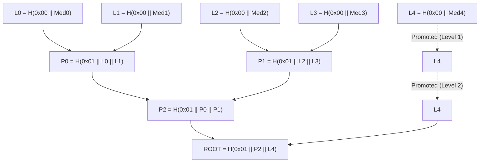

# MedicineGuard — Cryptographic Algorithm & Merkle Engine Design
**Course Alignment:** Design and Analysis of Algorithms (DAA) / Applied Cryptography  
**Academic Prototype:** Medicine Batch Traceability and Verification Using Merkle Trees  

---

## 1. Introduction: The Core Problem

In modern pharmaceutical supply chains, verifying individual medicine units across thousands of retail pharmacies is challenging:
- Committing thousands of individual digital signatures or database rows onto a centralized server or distributed ledger incurs high overhead.
- Centralized databases represent a single point of failure and vulnerability to retroactive tampering.
- Traditional hashing of an entire batch into a single hash permits batch validation, but requires downloading and hashing all $N$ units just to verify **one single box**.

### The Merkle Tree Solution
A **Merkle Tree** (invented by Ralph Merkle in 1979) is a cryptographic tree structure where:
1. Every leaf node represents the cryptographic digest (SHA-256) of an individual record.
2. Every non-leaf (internal) node is the cryptographic digest of its combined child nodes.
3. The single **Merkle Root** at the top forms a cryptographic commitment for all $N$ units in the batch.
4. An individual medicine unit can be proven to be an authentic member of the batch using an **audit path (Merkle Proof)** of length $\lceil \log_2 N \rceil$, without exposing or downloading the rest of the batch.

---

## 2. Cryptographic Primitive: SHA-256

### 2.1 Function Specification
MedicineGuard implements the **FIPS PUB 180-4 Secure Hash Standard (SHA-256)**.
- **Input:** Arbitrary length bit-string $M$.
- **Output:** Fixed 256-bit (32-byte) digest.
- **Block Size:** 512 bits (64 bytes).
- **Word Size:** 32 bits ($w = 32$).

### 2.2 Algorithmic Phases of SHA-256
1. **Preprocessing & Padding:**
   - Message length in bits: $L$.
   - A single `'1'` bit (`0x80`) is appended.
   - $k$ zero bits are appended such that $(L + 1 + k) \equiv 448 \pmod{512}$.
   - The 64-bit big-endian binary representation of $L$ is appended, completing the 512-bit block.
2. **Message Schedule Expansion:**
   - For each 64-byte block, the 16 32-bit words $W_0 \dots W_{15}$ are expanded into 64 words:
     $$W_t = \sigma_1(W_{t-2}) + W_{t-7} + \sigma_0(W_{t-15}) + W_{t-16} \quad (16 \le t \le 63)$$
3. **Compression Loop (64 Rounds):**
   - Eight working registers $(a, b, c, d, e, f, g, h)$ initialized with standard fractional prime constants ($H_0 \dots H_7$).
   - For $t = 0 \dots 63$:
     $$T_1 = h + \Sigma_1(e) + \text{Ch}(e, f, g) + K_t + W_t$$
     $$T_2 = \Sigma_0(a) + \text{Maj}(a, b, c)$$
     $$h = g, \quad g = f, \quad f = e, \quad e = d + T_1, \quad d = c, \quad c = b, \quad b = a, \quad a = T_1 + T_2$$
4. **Intermediate State Accumulation:**
   - $H_i^{(j)} = H_i^{(j-1)} + \text{register}_i$.

### 2.3 Security Properties Relevant to MedicineGuard
- **Preimage Resistance (One-Way):** Given root $R$, computationally infeasible to find message $M$ such that $H(M) = R$.
- **Second-Preimage Resistance:** Given $M_1$, computationally infeasible to find $M_2 \neq M_1$ such that $H(M_1) = H(M_2)$.
- **Collision Resistance:** Computationally infeasible to find any pair $(M_1, M_2)$ such that $H(M_1) = H(M_2)$.
- **Avalanche Effect:** Altering a single bit in a medicine unit ID or expiry date changes on average $50\%$ of the digest bits unpredictably.

---

## 3. Domain Separation (RFC 6962 Standard)

### 3.1 The Second-Preimage Attack on Naive Trees
In a naive binary Merkle Tree:
- Leaf hash: $H(data)$
- Parent hash: $H(left \parallel right)$

If an attacker is presented with an internal node $P_1 = H(L_0 \parallel L_1)$, the attacker can claim that $P_1$ is actually a leaf whose record data happens to be the 64-byte concatenation $(L_0 \parallel L_1)$. A naive verifier cannot distinguish an internal node from a leaf.

### 3.2 The Defense
MedicineGuard enforces **Domain Separation** using single-byte prefixes:
$$\text{Leaf Hash: } H_{\text{leaf}} = \text{SHA-256}(0x00 \parallel \text{serialized\_record})$$
$$\text{Parent Hash: } H_{\text{parent}} = \text{SHA-256}(0x01 \parallel \text{left\_hash} \parallel \text{right\_hash})$$

Because $0x00 \neq 0x01$, a parent node can never collide with a leaf node under SHA-256 collision resistance.

---

## 4. Merkle Tree Construction Algorithm

### 4.1 Odd Leaf Node Handling Rule
When batch size $N$ is not an exact power of 2:
- **Bitcoin Style (Duplicate Odd Node):** Causes historical vulnerability (CVE-2012-2459) where different tree depths collide.
- **MedicineGuard Standard (Promote Odd Node Unchanged):**
  If a level has an odd number of nodes $C$, the first $C - 1$ nodes form $(C-1)/2$ parent pairs. The solitary final node is **promoted directly to the next level without hashing**.

### 4.2 Example: 5-Leaf Tree ($N = 5$)



- **Level 0 (Leaves):** $[L_0, L_1, L_2, L_3, L_4]$ ($C_0 = 5$)
- **Level 1:** $P_0 = H(L_0, L_1)$, $P_1 = H(L_2, L_3)$, $L_4$ promoted. Nodes: $[P_0, P_1, L_4]$ ($C_1 = 3$)
- **Level 2:** $P_2 = H(P_0, P_1)$, $L_4$ promoted. Nodes: $[P_2, L_4]$ ($C_2 = 2$)
- **Level 3 (Root):** $\text{ROOT} = H(P_2, L_4)$. Nodes: $[\text{ROOT}]$ ($C_3 = 1$)

---

## 5. Merkle Proof Generation & Verification

### 5.1 Proof Structure
A Merkle Proof is the minimal set of sibling hashes required to ascend from the leaf to the root.
Each step records:
1. `hash`: 32-byte sibling digest.
2. `direction`: `SIBLING_LEFT (0)` or `SIBLING_RIGHT (1)`.

> **Odd Node Promotion Rule for Proofs:** When a node is promoted without a sibling, **no proof step is generated for that level**.

### 5.2 Proof Generation Pseudocode

```text
Algorithm GenerateMerkleProof(Tree, leaf_index):
    Input: Built MerkleTree, leaf_index (0 <= leaf_index < leaf_count)
    Output: MerkleProof structure

    curr_idx = leaf_index
    proof.step_count = 0
    proof.leaf_index = leaf_index
    proof.total_leaves = Tree.leaf_count

    for level = 0 to Tree.height - 2:
        count = Tree.levels[level].count
        if curr_idx % 2 == 0:
            if curr_idx + 1 < count:
                proof.steps[proof.step_count].hash = Tree.levels[level].hashes[curr_idx + 1]
                proof.steps[proof.step_count].direction = SIBLING_RIGHT
                proof.step_count++
            // else: curr_idx + 1 == count (promoted node, no step added)
        else:
            proof.steps[proof.step_count].hash = Tree.levels[level].hashes[curr_idx - 1]
            proof.steps[proof.step_count].direction = SIBLING_LEFT
            proof.step_count++

        curr_idx = curr_idx / 2

    return proof
```

### 5.3 Proof Verification Pseudocode

```text
Algorithm VerifyMerkleProof(Record, Proof, ExpectedRoot):
    Input: medicine_record_t Record, MerkleProof Proof, 32-byte ExpectedRoot
    Output: Boolean (True if valid, False if rejected)

    // 1. Compute leaf hash with domain separation 0x00
    current_hash = SHA256(0x00 || CanonicalSerialize(Record))

    curr_idx = Proof.leaf_index
    current_count = Proof.total_leaves
    steps_consumed = 0

    // 2. Ascend tree matching exact odd-node promotion rules
    while current_count > 1:
        if curr_idx % 2 == 0:
            if curr_idx + 1 < current_count:
                if steps_consumed >= Proof.step_count: return False
                if Proof.steps[steps_consumed].direction != SIBLING_RIGHT: return False
                current_hash = SHA256(0x01 || current_hash || Proof.steps[steps_consumed].hash)
                steps_consumed++
            // else: promoted node, no sibling consumed
        else:
            if steps_consumed >= Proof.step_count: return False
            if Proof.steps[steps_consumed].direction != SIBLING_LEFT: return False
            current_hash = SHA256(0x01 || Proof.steps[steps_consumed].hash || current_hash)
            steps_consumed++

        curr_idx = curr_idx / 2
        current_count = (current_count + 1) / 2

    // 3. Ensure all proof steps were consumed
    if steps_consumed != Proof.step_count: return False

    // 4. Constant-time root comparison
    return CryptoMemCmp(current_hash, ExpectedRoot, 32) == 0
```

---

## 6. Viva & Oral Exam Reference Questions

1. **Why is tree construction $O(N)$ and not $O(N \log N)$?**  
   Because the number of nodes at each level halves: $N + N/2 + N/4 + \dots + 1 = 2N - 1$. Computing $2N - 1$ hashes takes linear time $\Theta(N)$.
2. **Why does verification take $O(\log N)$ time?**  
   Because each level consumes at most one sibling hash. The path height is $\lceil \log_2 N \rceil$, requiring exactly $\le 14$ hash computations for $10,000$ items.
3. **What happens if someone changes 1 character in the batch ID?**  
   Due to SHA-256 avalanche effect, the leaf hash is completely randomized. As a result, climbing the tree produces a completely different root that fails constant-time comparison.
4. **Why do we promote odd nodes instead of duplicating them like Bitcoin?**  
   Duplicating odd nodes creates identical internal nodes that allow proof spoofing (CVE-2012-2459). Promoting solitary nodes prevents tree collisions.
